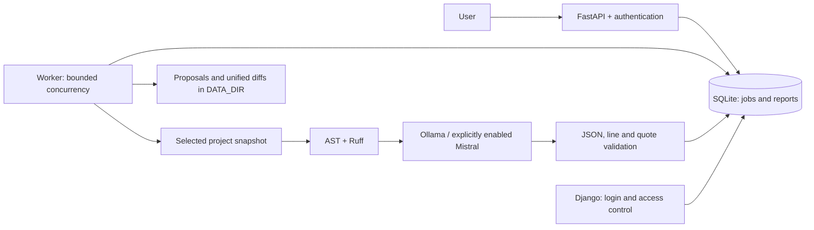

# Modernizing ai_code_reviewer

**English** · [Русский](ru/MODERNIZATION.md) · [README](../README.md) · [Validation evidence](VALIDATION.md)

The target platform is Python 3.14 on Linux, using local Ollama or static analysis without a model. The application moves from autonomous home-directory scanning to jobs that users explicitly request. Models produce reviewable recommendations, and project source files remain read-only.

## Architecture



The API does not start an endless scanner or create a worker inside each Uvicorn process. Start the separate worker with `python -m app.cli worker`. The SQLite queue suits a personal installation or small team. Higher job volumes require measurements and may justify a server database and dedicated queue.

Diff mode compares Git blobs at the selected revision with safely read working files using `ls-tree`/`cat-file` and content hashes. It does not call `git diff` or `git status`: custom clean filters in `.gitattributes` could otherwise execute commands even with external diff disabled. Changed-line ranges are conservative spans between a common prefix and suffix; unchanged lines between two edits may be included.

## Addressed problem classes

| Previous problem | Implementation | Validation |
| --- | --- | --- |
| Seeded `admin/admin` account and known JWT key | No automatic users; explicit account creation, Argon2, random development key, required production key | Wrong passwords, JWT claims, absence of seeded accounts |
| File operations outside the selected project | Relative paths, descriptor-based component checks, `O_NOFOLLOW`, symlink/hardlink and internal-directory exclusions | Traversal, links, special files, changes during reads |
| Public statistics and access to other users' reports | Django login and owner-scoped API jobs/reports | Unauthenticated and cross-user access |
| Model HTML/Markdown rendered in the interface | Plain-text responses, template escaping, restrictive CSP | HTML payloads remain text |
| Provider failures stored as successful reports | Typed exceptions, schema and evidence validation; transactional success recording after processing | 401/429/5xx, timeouts, invalid JSON and coordinates |
| Synchronous I/O in async endpoints | AsyncSession/aiosqlite and HTTPX; blocking file work moved off the event loop | Concurrent requests and jobs |
| Deprecated FastAPI lifecycle | Lifespan context and explicit resource shutdown | Repeated startup and shutdown |
| Unbounded scanning and temporary files named after uploads | Explicit project selection, limits, random upload identifiers | Large uploads, path-bearing filenames, repeated uploads |
| Different Compose database paths | One absolute `DATABASE_PATH` and a dedicated init service | Idempotent initialization and shared history |
| Incomplete dependencies and old CI | Python 3.14, `pyproject.toml`, `uv.lock`, hashed export, SHA-pinned GitHub Actions | Frozen installation, Ruff, mypy, pytest, Django, pip-audit |

`requests`, `aiohttp`, `python-jose`, `passlib`, and the unused Ollama SDK are replaced by a common HTTPX transport, PyJWT, and pwdlib. SQLAlchemy uses its async extra, including greenlet. Ruff is a runtime dependency because the worker also performs static analysis.

## Memory and concurrency

The previous implementation could hold a database session across a network request, repeatedly create HTTP clients, start a scanner without retaining a task reference, and accumulate scan results in lists. The new limits bound the selected review context independently of total repository size.

- HTTPX uses a bounded connection pool; its client closes when the worker stops.
- Database sessions are short-lived and are not shared across concurrent jobs. The engine closes during shutdown.
- Worker task counts are fixed. `TaskGroup`, timeouts, and cancellation wait for child tasks to finish.
- File, PDF, model-response, and subprocess-output sizes are bounded; directory traversal and subprocesses have depth/time limits.
- Short SQLite transactions serialize job creation, quotas, and deduplication. A lease and ownership token prevent a late worker from writing after cancellation or another worker's takeover.
- Intermediate artifacts are isolated per attempt; the source project is not overwritten.
- Cache keys include snapshot content and processing policy. Results belonging to different users are kept separate.

These changes address specific causes of uncontrolled growth and races; they do not prove the absence of all memory leaks. `python -m app.evaluate` measures time and peak `tracemalloc` usage for a small reproducible static-rule dataset. Production profiling requires a sustained load test, process RSS measurements, and monitoring of database/artifact growth. No before/after speedup is claimed without equivalent inputs and hardware.

Uploads, history, and artifacts can grow on disk. Use `uv run --frozen python -m app.cli prune --days 30 --limit 100` to remove one batch of old terminal jobs, their snapshots, and artifacts. Report history is retained unless `--include-reports` is supplied; active jobs are preserved. Automatic scheduled deletion is not configured. Select a retention and backup policy appropriate to the installation; the cache is not a replacement for it.

## Upgrading an existing installation

1. Stop the old API, admin, and worker processes. Save configuration separately, and replace legacy default keys and passwords.
2. Install dependencies with `uv sync --frozen`.
3. Create a consistent SQLite backup. For the default database path:

```bash
uv run --frozen python - <<'PY'
import sqlite3
from pathlib import Path

Path('.data').mkdir(exist_ok=True)
with sqlite3.connect('file:database.db?mode=ro', uri=True) as source:
    with sqlite3.connect('.data/pre-modernization.sqlite3') as backup:
        source.backup(backup)
PY
```

4. Configure the same `DATABASE_PATH`, `DATA_DIR`, and `SECRET_KEY` for every process. Production requires a random key of at least 32 characters. Changing the key invalidates existing JWTs.
5. Run `uv run --frozen python -m app.cli init-db`. Migrations are additive and versioned; existing reports are preserved. Administrators can access legacy reports that have no owner.
6. Migration disables the old automatically created API `admin` account. Create a separate user or explicitly reset and reactivate it with `uv run --frozen python -m app.cli create-user admin --admin --reset-password`.
7. Run Django `migrate`, `collectstatic`, and, if needed, `createsuperuser`. Start the services using the README, then check login, project listing, a static review, and its completed job result.

For rollback, stop all processes and restore a matching set of source code, lockfile, and database backup. Check compatibility before running old code against a migrated schema.

## Code proposals and isolation

The model returns JSON containing individual files. The server validates paths and Python syntax, produces a unified diff, and stores the proposal in `DATA_DIR`. Patch validation rejects unsupported operations and mismatched source context. The user can inspect the proposal before applying it.

Generated code is untrusted. Running its tests requires a supported sandbox with bounded resources and networking disabled. Without one, the result explicitly reports `unavailable`; tests have not run. Syntax validation does not establish correct behavior, security, or migration correctness. Proposals are never automatically applied to the source repository.

The Docker sandbox uses a preloaded `python:3.14.8-slim` image, does not download dependencies during tests, and runs standard-library `unittest`. Set `RUN_DOCKER_TESTS=1` for the separate integration checks: a real container verifies disabled networking, UID 65534, no inherited secrets or `.env`, read-only source access, and forced termination of an infinite test. Pytest and third-party dependencies require a prebuilt trusted image; the runner function accepts such an image, but automatic environment management for arbitrary projects is not implemented.

## Customization profiles

| Profile | Configuration | Practical result |
| --- | --- | --- |
| Personal local assistant | Ollama, small file limit, one worker | Source is processed on the local machine |
| Deterministic CI | `AI_PROVIDER=static`, diff mode, JSON/SARIF | Repeatable checks without a model or API key |
| Team reviews | User accounts, owner-scoped history, PR workflow | Separate results and review artifacts |
| Cloud model | Mistral, explicit opt-in, configured prices and budget | AI suggestions with controlled provider access |
| Legacy modernization | Migration/test proposals and a separate sandbox | Reviewable changes before manual application |

Evaluate RAG, MCP, or multiple agents against a labeled defect dataset before adding them. A useful next step is a corpus of real diffs with agreed expected findings and measurements of precision, cost, and latency. The current benchmark covers a limited set of AST rules; its results cannot be generalized to LLM quality.

## Operating limits

Job AI budgets are stored in the shared database by UTC day. Atomic reservations in integer microdollars cover all workers in that installation and survive restarts. A reservation is made before every network attempt. Ambiguous failures do not refund it because the provider may already have processed the request. Separate databases have separate limits. Direct transport use outside the worker retains an instance-local limit. Operators supply token prices; the application does not fetch current pricing. Also configure a financial limit with the provider.

An API key, a passing static test, or a successful `/readyz` response does not verify real Mistral/Ollama operation. Run a separate request against the configured provider, and check that the selected local model returns complete output conforming to the JSON schema. See [validation evidence](VALIDATION.md) ([русский](ru/VALIDATION.md)) for the distinction between completed checks and outstanding integration checks.

Python and uv base images in the Dockerfile are pinned by verified digests. Ollama images and weights are outside `uv.lock`; pin verified image digests/tags and model versions for deployment. The API and Django default to loopback binding; expose them publicly through an HTTPS proxy. SQLite and the current login limiter are not designed for unrestricted horizontal scaling.
