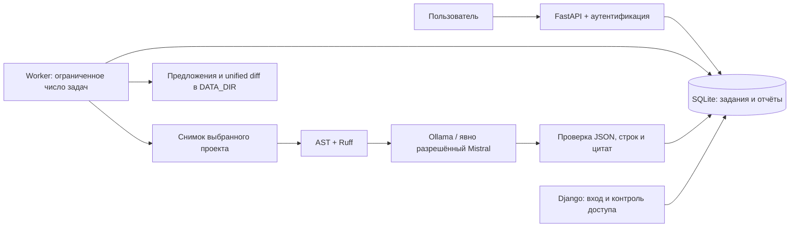

# Модернизация ai_code_reviewer

[English](../MODERNIZATION.md) · **Русский** · [Установка и запуск](../../README.ru.md) · [Результаты проверки](VALIDATION.md)

Целевая платформа — Python **3.14.8**, Linux, локальный Ollama или статический анализ без модели. Изменение переводит приложение от автономного сканирования домашнего каталога к заданиям, которые пользователь запускает явно. Модель выдаёт проверяемые рекомендации; доступ к исходникам остаётся только для чтения.

## Архитектура



API не запускает бесконечный фоновый сканер и не создаёт worker внутри каждого процесса Uvicorn. Worker запускается отдельно через `python -m app.cli worker`. Локальная очередь SQLite подходит для персональной установки и небольшой команды; большой поток заданий потребует измерений и перехода к серверной БД/очереди.

Режим diff сравнивает Git blobs выбранной ревизии с безопасно прочитанными рабочими файлами через `ls-tree`/`cat-file` и хеши. `git diff`/`status` не вызываются: пользовательские clean filters из `.gitattributes` иначе могли бы запускать команды даже при отключённом внешнем diff. Диапазон изменённых строк определяется консервативно между общим префиксом и суффиксом; между двумя изменениями он может включать неизменённые строки.

## Исправленные классы проблем

| Прежняя проблема | Принятое решение | Как проверять |
| --- | --- | --- |
| `admin/admin` и известный JWT-ключ | Нет автоматических пользователей; явное создание, Argon2, случайный ключ разработки, обязательный ключ production | Тесты неверного пароля, claims JWT, отсутствия seed-аккаунта |
| Файловые операции вне выбранного проекта | Относительные пути, проверка каждого компонента через дескрипторы, `O_NOFOLLOW`, запрет symlink/hardlink и служебных каталогов | Traversal, ссылки, специальные файлы, изменение файла во время чтения |
| Открытая статистика и чужие отчёты | Django login, привязка API-заданий и отчётов к владельцу | Неавторизованный доступ и доступ другого пользователя |
| HTML/Markdown модели в интерфейсе | Отображение ответа как текста, экранирование шаблонов, ограничительная CSP | HTML-полезная нагрузка остаётся текстом |
| Сбой модели сохраняется как успех | Типизированные исключения, валидация схемы и цитат; успешный отчёт записывается транзакционно после обработки | 401/429/5xx, timeout, неверный JSON, неверные координаты |
| Синхронный ввод-вывод в async endpoints | AsyncSession/aiosqlite и HTTPX; блокирующая работа с файлами вынесена из event loop | Конкурирующие запросы и задания |
| Устаревший lifecycle FastAPI | Lifespan-контекст и явное завершение ресурсов | Повторный запуск и остановка приложения |
| Неограниченное сканирование и временные файлы по имени загрузки | Явный выбор проекта, лимиты, случайные идентификаторы загрузок | Большая загрузка, имена с путями, повторные загрузки |
| Разные пути БД в Compose | Один абсолютный `DATABASE_PATH`, отдельный init перед сервисами | Идемпотентный init и чтение общей истории |
| Неполные зависимости и старый CI | Python 3.14, `pyproject.toml`, `uv.lock`, экспорт с хешами, CI на закреплённых Actions SHA | Frozen install, Ruff, mypy, pytest, Django, pip-audit |

`requests`, `aiohttp`, `python-jose`, `passlib` и неиспользуемый SDK Ollama заменены единым HTTPX-транспортом, PyJWT и pwdlib. SQLAlchemy использует async extra, включающий greenlet. Ruff нужен в runtime: статическая проверка выполняется также внутри worker.

## Память и параллелизм

Старый код мог удерживать одну сессию на время сетевого запроса, повторно создавать HTTP-клиенты, запускать незавершаемый scanner без сохранённой ссылки и накапливать результаты сканирования в списках. Новые ограничения не дают размеру выбранного контекста расти вместе со всем репозиторием.

- HTTPX использует ограниченный пул соединений; клиент закрывается при завершении worker.
- Сессии БД короткие и не разделяются между параллельными заданиями. Движок закрывается при остановке.
- Число worker-задач фиксировано. `TaskGroup`, таймауты и отмена дожидаются завершения дочерних задач.
- Файлы, PDF, ответы модели и вывод подпроцессов ограничены по размеру; обход каталогов и процессы имеют пределы глубины/времени.
- Создание задания, квота и дедупликация сериализованы короткой транзакцией SQLite. Lease и токен владения не дают опоздавшему worker записать результат после отмены или перехвата задания.
- Промежуточные артефакты создаются отдельно для каждой попытки; исходный проект не перезаписывается.
- Ключ кэша учитывает содержимое снимка и политику обработки. Результаты разных пользователей не смешиваются.

Это устраняет конкретные источники неконтролируемого роста и гонок, но не является доказательством отсутствия любых утечек. `python -m app.evaluate` измеряет время и пик `tracemalloc` для небольшого повторяемого набора статических правил. Для производственного профиля нужны длительный нагрузочный прогон, RSS процесса и наблюдение за размером БД/артефактов. Сравнение «до/после» без одинакового входного набора и оборудования не заявляется.

Загрузки, история и артефакты могут увеличивать использование диска. Для явной очистки есть `uv run --frozen python -m app.cli prune --days 30 --limit 100`: одна порция старых завершённых, ошибочных и отменённых заданий, их снимков и артефактов. История отчётов сохраняется, если не указан `--include-reports`; активные задания не удаляются. Автоматического удаления по расписанию нет: выберите политику хранения и резервного копирования под свои требования. Кэш не заменяет эту политику.

## Переход с прежней установки

1. Остановите старые API/admin/worker. Сохраните конфигурацию отдельно; не переносите старые стандартные ключи и пароли.
2. Установите зависимости `uv sync --frozen`.
3. Сделайте консистентную резервную копию SQLite. Для стандартного пути:

```bash
uv run --frozen python - <<'PY'
import sqlite3
from pathlib import Path

Path('.data').mkdir(exist_ok=True)
with sqlite3.connect('file:database.db?mode=ro', uri=True) as source:
    with sqlite3.connect('.data/pre-modernization.sqlite3') as backup:
        source.backup(backup)
PY
```

4. Настройте одинаковые `DATABASE_PATH`, `DATA_DIR` и `SECRET_KEY` для всех процессов. Production требует непустого случайного секрета. Прежние JWT после смены ключа перестают действовать.
5. Выполните `uv run --frozen python -m app.cli init-db`. Миграция аддитивная и версионированная; существующие отчёты сохраняются. Legacy-отчёты без владельца доступны администраторам.
6. Старый автоматически созданный API `admin` отключается. Создайте отдельного пользователя либо явно сбросьте его пароль: `python -m app.cli create-user admin --admin --reset-password` через `uv run --frozen`.
7. Выполните Django `migrate`, `collectstatic`, `createsuperuser` при необходимости. Запустите сервисы по [README](../../README.ru.md) и проверьте вход, список проектов, статическое ревью и результат задания.

Для отката остановите все процессы и восстановите согласованные код, lockfile и резервную копию БД. Не запускайте старый код на уже изменённой схеме без проверки совместимости.

## Предложения кода и изоляция

Модель возвращает JSON с отдельными файлами. Сервер проверяет пути и синтаксис Python, формирует unified diff и сохраняет предложение в `DATA_DIR`. Проверка patch отклоняет неподдерживаемые операции и несовпадающий исходный контекст. Пользователь видит предложение до применения.

Сгенерированный код считается недоверенным. Запуск тестов требует отдельной поддерживаемой песочницы с ограниченными ресурсами и отключённой сетью. Если она отсутствует, результат явно сообщает `unavailable`; это не успешное выполнение тестов. Проверка синтаксиса не подтверждает поведение, отсутствие уязвимостей или корректность миграции. Автоматического применения предложения к исходному репозиторию нет.

Docker-песочница использует заранее доступный `python:3.14.8-slim`, не скачивает зависимости во время теста и выполняет стандартные `unittest`. Отдельная интеграционная проверка запускается с `RUN_DOCKER_TESTS=1`: реальный контейнер проверяет отключённую сеть, UID 65534, отсутствие переданных секретов и `.env`, доступ к исходникам только для чтения и принудительное завершение бесконечного теста. Для pytest и сторонних библиотек нужен заранее подготовленный доверенный образ; такой образ можно передать API функции runner, автоматического управления окружениями произвольных проектов пока нет.

## Профили кастомизации

| Профиль | Настройка | Практический результат |
| --- | --- | --- |
| Персональный локальный | Ollama, небольшой лимит файлов, один worker | Код обрабатывается на локальной машине |
| Детерминированный CI | `AI_PROVIDER=static`, diff, JSON/SARIF | Повторяемая проверка без модели и API-ключа |
| Командное ревью | Пользователи, owner-scoped история, PR workflow | Изолированные результаты и артефакты для ревью |
| Облачная модель | Mistral, явное согласие, цены и бюджет | AI-рекомендации с контролируемым доступом к провайдеру |
| Legacy-модернизация | Предложения migration/tests и отдельная песочница | Проверяемые изменения перед ручным применением |

Добавлять RAG, MCP или несколько агентов стоит после оценки на собственном наборе размеченных дефектов. Следующий измеримый шаг — корпус реальных diff с согласованными ожидаемыми замечаниями, метриками точности, стоимости и времени. Текущий benchmark покрывает ограниченные AST-правила; его результат нельзя переносить на качество LLM.

## Эксплуатационные границы

Бюджет AI для заданий хранится в общей БД по суткам UTC. Атомарные резервирования в целых микродолларах учитывают все worker этой установки и переживают перезапуск; резервирование выполняется до каждой попытки сетевого запроса. Неоднозначные сбои не возвращают резерв, поскольку провайдер мог обработать запрос. Отдельные БД имеют отдельные лимиты. Прямое использование транспорта без worker сохраняет локальный лимит экземпляра. Параметры цены задаёт оператор; приложение не получает актуальные тарифы автоматически. Дополнительный финансовый лимит задаётся у провайдера.

Наличие API-ключа, успешный статический тест или ответ `/readyz` не подтверждают работу реального Mistral/Ollama. Для проверки модели нужен отдельный запрос к настроенному провайдеру. Отдельно проверяйте полноту ответа и соответствие JSON-схеме выбранной локальной модели.

Базовые образы Python/uv в Dockerfile закреплены проверенными digest. Образ и веса Ollama находятся вне `uv.lock`; для развёртывания закрепите их проверенные digest/tag и версии моделей. API и Django по умолчанию слушают loopback, а публичный доступ организуется через HTTPS-прокси. SQLite и текущий лимитер входа не предназначены для неограниченного горизонтального масштабирования.
